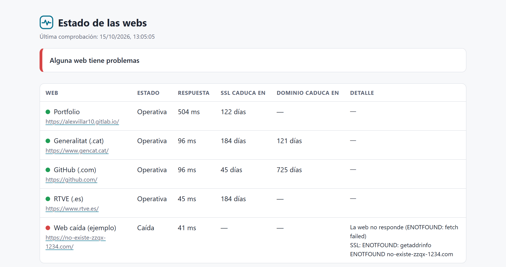

# monitor-webs

[](https://github.com/Alexyz17/monitor-webs/actions/workflows/test.yml)

Vigila webs y avisa antes de que el cliente se dé cuenta: comprueba que responden, cuánto tardan, cuándo caduca el certificado SSL y cuándo caduca el dominio. Envía alertas por Telegram o por webhook (Discord, Slack, n8n…) y genera una página de estado en HTML.

**Sin dependencias**: solo Node.js 20 o superior. No hay que ejecutar `npm install`.



## Qué comprueba

| Comprobación | Caída 🔴 | Aviso 🟠 |
| --- | --- | --- |
| Disponibilidad HTTP | Responde 4xx/5xx o no responde | Tarda más de `slowMs` |
| Certificado SSL | Caducado o no válido | Caduca en menos de `sslWarnDays` días |
| Dominio (RDAP) | Caducado | Caduca en menos de `domainWarnDays` días |

Las alertas no se repiten: se envían cuando cambia el estado, cuando cambian los problemas o, si una web sigue mal, una vez cada `repeatHours` horas. Cuando la web se recupera, llega un aviso de vuelta a la normalidad.

El dominio se consulta por [RDAP](https://about.rdap.org/), como mucho cada 12 horas. Algunos registros (por ejemplo, `.es`) no publican la fecha de caducidad; en ese caso la comprobación se ignora sin dar error.

## Uso rápido

```bash
cp sites.example.json sites.json   # edita la lista de webs
npm run once                       # una pasada y sale (código 1 si alguna web está caída)
npm start                          # vigila en bucle cada intervalMinutes
npm test                           # 17 tests con node:test
```

La página de estado se escribe en `public/index.html` y el estado entre ejecuciones en `data/state.json`. Las rutas se cambian con `CONFIG_PATH`, `STATE_PATH` y `STATUS_PAGE_PATH`.

## Configuración (`sites.json`)

| Campo | Por defecto | Qué hace |
| --- | --- | --- |
| `title` | Estado de las webs | Título de la página de estado |
| `intervalMinutes` | 5 | Cada cuánto se comprueba en modo bucle |
| `sslWarnDays` | 14 | Días antes de la caducidad del SSL para avisar |
| `domainWarnDays` | 30 | Días antes de la caducidad del dominio para avisar |
| `slowMs` | 3000 | Respuesta más lenta que esto = aviso |
| `timeoutMs` | 10000 | Tiempo máximo de cada comprobación |
| `repeatHours` | 24 | Cada cuánto se repite una alerta que sigue activa |
| `sites[].url` | — | Obligatorio, `http` o `https` |
| `sites[].name` | el dominio | Nombre que aparece en alertas y página |
| `sites[].checkSsl` | `true` en https | `false` para no revisar el certificado |
| `sites[].checkDomain` | `true` | `false` para subdominios ajenos (por ejemplo, `gitlab.io`) |
| `sites[].domain` | calculado | Fuerza el dominio a consultar |

## Alertas

Copia `.env.example` a `.env` y rellena uno o los dos canales:

- **Telegram**: crea un bot con @BotFather, guarda el token en `TELEGRAM_BOT_TOKEN` y tu chat en `TELEGRAM_CHAT_ID`.
- **Webhook**: `ALERT_WEBHOOK_URL` recibe un POST con `{ "text": "...", "content": "..." }`, compatible con Discord y Slack.

Sin canales configurados, las alertas salen por consola. En Node 20.6 o superior se puede cargar el `.env` con `node --env-file=.env src/index.js`.

## Despliegue

**Docker Compose** (monitor + página de estado en http://localhost:8080):

```bash
docker compose up -d --build
```

**CI**: GitHub Actions pasa los tests con Node 20, 22 y 24 en cada push.

**GitLab CI + Pages** sin servidor: `.gitlab-ci.yml` pasa los tests en cada push. Con una *pipeline schedule* (por ejemplo cada hora), comprueba las webs y publica la página en GitLab Pages. Pon el contenido de `sites.json` en la variable `SITES_JSON` y las credenciales de alertas como variables protegidas.

## Estructura

```
src/
  checks.js    comprobaciones HTTP, SSL y dominio
  evaluate.js  nivel de cada web y cuándo avisar
  notify.js    Telegram y webhook
  report.js    página de estado
  config.js    lectura y validación de sites.json
  index.js     orquestación, estado y modo bucle
test/          tests con node:test
```

## Licencia

MIT · Alex Villar Gracia
